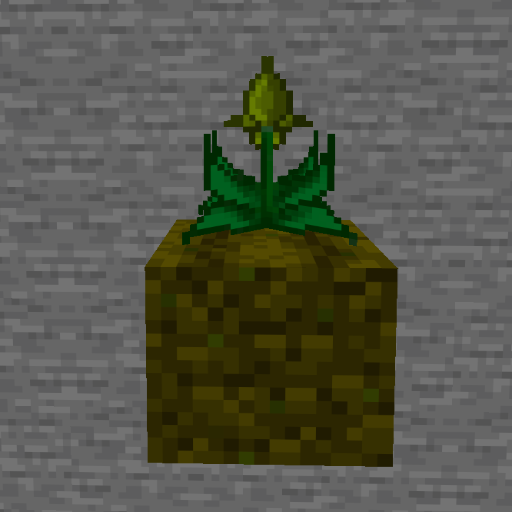

# Mystical Agriculture: Replanted



An unofficial port of Mystical Agriculture to Minecraft 26.3 and NeoForge.

## Overview

Mystical Agriculture: Replanted brings the original Mystical Agriculture experience to Minecraft 26.3, allowing players to grow resources, materials, mob essences, and more through magical agriculture.

This project focuses on compatibility with newer Minecraft and NeoForge versions while preserving the original gameplay, mechanics, and mod identity.

## Port Changes

- Updated to Minecraft 26.3.
- Updated to NeoForge 26.3 and NeoForge APIs while maintaining Java 25 compatibility.
- Migrated outdated Minecraft and NeoForge APIs.
- Updated crop models, item models, and generated resources.
- Updated crafting recipes and loot tables.
- Migrated world generation features.
- Updated machine, container, and inventory implementations.
- Updated block entity rendering and client-side functionality.
- Updated networking and data generation.
- Updated JEI and Jade development dependencies.
- Added compatibility with Cucumber: Re-Pickled.
- Preserved original mod IDs, registry names, and Java package structure.
- Updated build configuration and dependency management.

Patchouli integration is temporarily disabled due to version incompatibility.

## Downloads

- [Mystical Agriculture: Replanted on CurseForge](https://www.curseforge.com/minecraft/mc-mods/mystical-agriculture-replanted)
- [Cucumber Library: Re-Pickled on CurseForge](https://www.curseforge.com/minecraft/mc-mods/cucumber-library-re-pickled)

## Requirements

| Requirement | Version |
|---|---|
| Minecraft | 26.3 |
| Mod Loader | NeoForge |
| NeoForge | 26.3.0.115 or newer compatible version |
| Java | 25 |
| Cucumber: Re-Pickled | 0.1.0 or newer compatible version |

## Building from Source

### Prerequisites

- JDK 25
- Git
- Internet connection for Gradle dependencies
- Cucumber: Re-Pickled installed in the local Maven repository

### 1. Build Cucumber: Re-Pickled

Clone the Cucumber repository:

```bash
git clone https://github.com/Kiyoshibara/Cucumber-Re-Pickled.git
cd Cucumber-Re-Pickled
git checkout 26.3
```

Windows:

```cmd
gradlew.bat clean build publishToMavenLocal
```

Linux / macOS:

```bash
./gradlew clean build publishToMavenLocal
```

This publishes Cucumber to your local Maven repository.

### 2. Clone Mystical Agriculture: Replanted

```bash
cd ..
git clone https://github.com/Kiyoshibara/Mystical-Agriculture-Replanted.git
cd Mystical-Agriculture-Replanted
git checkout 26.3
```

### 3. Build the Mod

Windows:

```cmd
gradlew.bat clean build
```

Linux / macOS:

```bash
./gradlew clean build
```

The compiled artifacts will be generated in `build/libs/`.

- Standard mod JAR
- Sources JAR
- API JAR

To publish Mystical Agriculture to your local Maven repository for addon development:

Windows:

```cmd
gradlew.bat publishToMavenLocal
```

Linux / macOS:

```bash
./gradlew publishToMavenLocal
```

## Development

- Language: Java 25
- Build System: Gradle
- Mod Loader: NeoForge
- Recommended IDE: IntelliJ IDEA

The original mod ID, registry names, and package structure are intentionally preserved to maintain compatibility wherever possible.

## Versioning

This port uses an independent versioning system.

The initial port release is `0.1.0`, independent of the original Mystical Agriculture release numbering.

## Original Project

Mystical Agriculture was originally created by BlakeBr0.

- [Original GitHub Repository](https://github.com/BlakeBr0/MysticalAgriculture)
- [Original CurseForge Project](https://www.curseforge.com/minecraft/mc-mods/mystical-agriculture)
- [Original Documentation](https://blakesmods.com/docs/mysticalagriculture)

### Upstream Source

- Original branch: `26.1`
- Original version: `9.0.11`
- Base commit: [`3478be1900dfd608b480d3a58434f54d87ff26cd`](https://github.com/BlakeBr0/MysticalAgriculture/commit/3478be1900dfd608b480d3a58434f54d87ff26cd)

## Credits

- **BlakeBr0** — Original creator and developer.
- **Original contributors** — Contributions to the original Mystical Agriculture project.
- **Kiyoshibara** — Unofficial Minecraft 26.3 port and maintenance.

This is an independent, unofficial port. It is not affiliated with, endorsed by, or maintained by the original developer.

## License

This project is licensed under the MIT License.

Original copyright © 2018 BlakeBr0.

The original copyright and license notices are preserved. See [LICENSE](LICENSE) for the full license text.

## Issues and Support

Please report issues specific to this port through its GitHub Issues page.

- [Report an Issue](https://github.com/Kiyoshibara/Mystical-Agriculture-Replanted/issues)

Please do not report port-specific issues to the original Mystical Agriculture repository.

## Contact

Development inquiries: kiyoshibaradev@gmail.com

## Support Development

If you enjoy this port and would like to support continued development and future updates, you can support me on Patreon.

❤️ **Patreon:** [Kiyoshibara](https://www.patreon.com/c/Kiyoshibara)